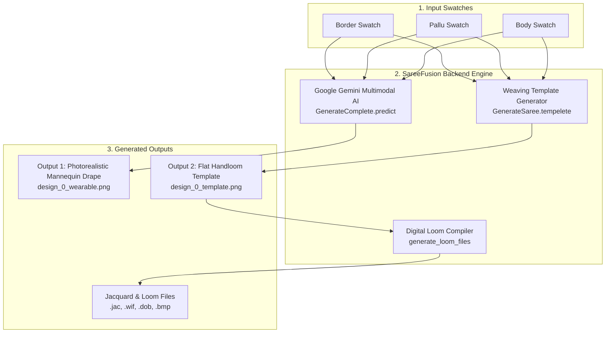

# 👗 SareeFusion

**AI-Powered Custom Saree Design Automation & Digital Loom Platform**

SareeFusion is an intelligent end-to-end design automation platform that empowers users to create personalized Indian saree designs by combining custom **Body**, **Pallu**, and **Border** components. The system synthesizes photorealistic draped mannequin visualizations using **Google Gemini Multimodal AI** and produces authentic **handloom-ready weaving graphs and digital Jacquard loom files** (`.jac`, `.wif`, `.dob`, `.bmp`).

---

## 📖 Overview

Traditional saree selection often forces compromises—customers might love the border of one saree, the pallu of another, and the body fabric of a third. SareeFusion bridges this gap by allowing designers and customers to mix and match individual components into a single custom saree.

When a saree is generated, the platform produces **two distinct, production-ready outputs**:
1. **Wearable View (Output 1)**: A photorealistic studio photograph of an elegant mannequin wearing the custom saree with authentic drape, 3D folds, and natural pleating.
2. **Template View (Output 2)**: A flat handloom weaving graph layout featuring continuous top and bottom borders, seamless body fabric tiling (70% width), and the pallu end-piece (30% width).

---

## ✨ Features

- 🎨 **Component Mix-and-Match Studio**:
  - **Body**: Base color, weave texture, and zari butti motifs.
  - **Pallu**: Grand decorative end-piece with floral and kalka artwork.
  - **Border**: Gold and silver zari border running along the drape margins.
- 👗 **Dual-View Generation**:
  - Photorealistic **Wearable View** draped on a mannequin.
  - Full-resolution **Weaving Template View** for handloom master weavers.
- 🤖 **Google Gemini Multimodal AI Engine**:
  - Takes 3 component swatches directly as multimodal input.
  - Generates cohesive, photorealistic drape previews without requiring manual cutout masks.
- 🧵 **Digital Jacquard & Loom Compiler**:
  - **Traditional Jacquard**: Visual grid bitmap (`jacquard.bmp`) & 200-hook punch cards (`punch_cards.txt`).
  - **Digital Jacquard**: Staubli JC5 format (`digital_pattern.jac`) & WIF tie-up plan (`digital_tieup.wif`).
  - **Dobby Loom**: Harness lift plan (`dobby_plan.dob`) & draw plan (`draw_plan.txt`).
  - **Yarn & Warp/Weft Palette**: Automatic dominant color extraction and palette matching.
- 🔐 **Authentication & Order Management**:
  - Secure weaver & customer accounts (toggleable via `AUTH_ENABLED=false`).
  - Batch history, collections gallery, and PDF tech-pack downloads.

---

## 🏗️ System Architecture



---

## 🛠️ Technology Stack

### Frontend
- **Framework**: [React 19](https://react.dev/) + [Vite](https://vitejs.dev/)
- **Routing**: React Router DOM (v7)
- **Styling**: Vanilla CSS (modular design tokens, glassmorphism, responsive)
- **Icons**: Lucide React

### Backend
- **Framework**: [Flask](https://flask.palletsprojects.com/) + Flask-CORS
- **Language**: Python 3.10+
- **Image Processing**: OpenCV (`opencv-python-headless`), Pillow (`PIL`), NumPy
- **Generative AI**: Google GenAI SDK (`google-genai`), Gemini Multimodal models

---

## 📁 Project Structure

```
saree-fusion/
├── backend/
│   ├── main.py                 # Core Flask API & loom compilation routes
│   ├── saree_generator.py      # Weaving template builder & Gemini AI predictor
│   ├── requirements.txt        # Backend Python dependencies
│   ├── .env                    # Backend environment configuration
│   ├── batches.json            # Persistent batch storage
│   ├── orders.json             # Persistent orders storage
│   └── static/
│       ├── assets/             # Swatches, mannequin base, and reference images
│       ├── batches/            # Output batches (wearable & template PNGs)
│       └── orders/             # Generated Jacquard & loom file packages
├── frontend/
│   ├── src/
│   │   ├── pages/              # Design Studio, Collections, Orders, Auth
│   │   ├── components/         # Navbar, ProtectedRoute, gallery cards
│   │   ├── App.jsx             # React routing and application shell
│   │   └── App.css             # Unified styling and animations
│   ├── package.json            # Frontend npm dependencies
│   └── vite.config.js          # Vite development server configuration
└── README.md
```

---

## 🚀 Getting Started

### 1. Prerequisites
- **Node.js** (v18+) & **npm**
- **Python** (v3.10+) & **pip**
- (Optional) **Google Gemini API Key** for direct cloud AI image generation.

---

### 2. Backend Setup

```bash
# Navigate to the backend directory
cd backend

# Create and activate a virtual environment (optional but recommended)
python -m venv venv
# On Windows:
venv\Scripts\activate
# On Linux/macOS:
source venv/bin/activate

# Install dependencies
pip install -r requirements.txt

# Configure environment variables in backend/.env:
# AUTH_ENABLED=true
# GEMINI_API_KEY=your_gemini_api_key

# Start the Flask backend server (runs on http://localhost:5000)
python main.py
```

---

### 3. Frontend Setup

```bash
# In a new terminal, navigate to the frontend directory
cd frontend

# Install dependencies
npm install

# Start the Vite development server (runs on http://localhost:5173)
npm run dev
```

Open [http://localhost:5173](http://localhost:5173) in your browser.

---


## 🔌 API Endpoints Summary


| Method | Endpoint | Description |
| :--- | :--- | :--- |
| `POST` | `/api/generate` | Uploads 3 swatches and generates wearable + template outputs |
| `GET` | `/api/batches` | Retrieves all generated design batches |
| `GET` | `/api/batches/<id>` | Retrieves a specific design batch and its design assets |
| `POST` | `/api/orders` | Places a production order and generates loom files |
| `GET` | `/api/orders` | Lists all customer and weaver orders |
| `GET` | `/api/orders/<id>/download/<file>` | Downloads punch cards, `.jac`, `.wif`, or `.dob` loom files |
| `POST` | `/api/auth/login` | Authenticates weaver / customer accounts |
| `POST` | `/api/auth/register` | Registers a new account |

---

## 📄 License

This project is developed for custom handloom automation and textile innovation.
Distributed under the MIT License.
